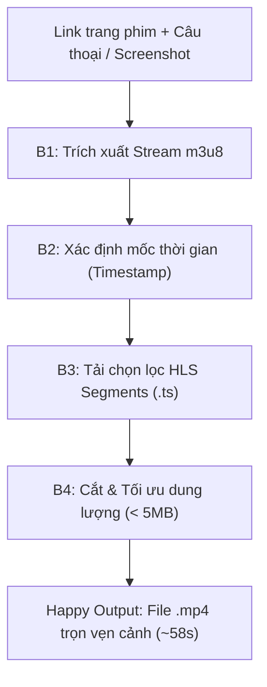

# 001-movie-scene-cutter

Chuyên trích xuất và cắt chính xác các đoạn hội thoại đắt giá từ các trang xem phim trực tuyến (như Motchill, web phim HLS/m3u8), đảm bảo **Happy Output**: phân đoạn video MP4 hoàn chỉnh cả về bối cảnh dẫn dắt và kết thúc cảm xúc (khoảng ~58s), đồng thời tối ưu hóa dung lượng **< 5MB** để tiện chia sẻ và tải lên các nền tảng mạng xã hội / ứng dụng chat.

---

## 1. Input & Happy Output

### Input
* **Link trang phim:** URL tập phim trên web xem phim (ví dụ: `https://motchillu.cx/phim/di-den-noi-co-gio/tap-34-sv-0`).
* **Chi tiết cảnh/câu thoại cần cắt:**
  * Câu thoại đặc trưng (ví dụ: *"Mẹ tôi từng nói: Đừng để bụng đói mà đi..."*).
  * Ảnh chụp màn hình player có mốc thời gian (nếu có).
  * Hoặc khoảng thời gian ước tính (ví dụ: *"khoảng phút 31"*).

### Happy Output
* **File video `.mp4` bản đầy đủ (~58s):**
  * Không cắt cụt lủn chỉ riêng câu thoại: Giữ trọn mạch cảm xúc bao gồm lời dẫn thoại trước đó (setup) + câu thoại đắt giá + phản ứng/hành động kết thúc của nhân vật (payoff).
  * Hình ảnh sắc nét (720p / 1080p), phụ đề (Vietsub) rõ ràng, âm thanh gốc đồng bộ.
  * Dung lượng file được kiểm soát nghiêm ngặt: **dưới 5MB** (thường từ 3.2MB – 3.8MB) để dễ dàng upload lên Discord, Zalo, Messenger, v.v.

---

## 2. Quy trình thực hiện (Step-by-Step Workflow)



### Bước 1: Trích xuất Stream HLS (m3u8) từ trang web
Quét mã nguồn trang web để tìm link phát stream trực tiếp (`.m3u8`):
```python
import urllib.request, re

req = urllib.request.Request(movie_url, headers={'User-Agent': 'Mozilla/5.0...'})
html = urllib.request.urlopen(req, timeout=10).read().decode('utf-8')

# Tìm link m3u8 trong HTML hoặc config player
m3u8_links = re.findall(r'https?://[^\s"\'<>]+\.m3u8[^\s"\'<>]*', html)
```

### Bước 2: Xác định mốc thời gian chính xác của câu thoại
1. **Nếu có phụ đề rời hoặc captions:** Tìm kiếm chuỗi từ khóa trong subtitle track.
2. **Nếu phụ đề hardcode vào video (như Vietsub trên web phim):**
   * Tải trước các segment `.ts` xung quanh mốc thời gian người dùng cung cấp (ví dụ ± 1 phút).
   * Trích xuất frame (1 frame/giây) và sử dụng OCR (như công cụ có sẵn `ocr_frames.swift` dùng Apple Vision framework trên macOS) để đọc chính xác từng giây hiển thị câu thoại:
   ```bash
   swift scripts/ocr_frames.swift <thư_mục_chứa_frames>
   ```
   * Xác định điểm bắt đầu của ngữ cảnh (ví dụ: trước câu nói 10–15 giây) và điểm kết thúc cảnh (sau khi nhân vật đáp lời hoặc gật đầu đồng ý).

### Bước 3: Tải chọn lọc phân đoạn (Selective Segment Download)
* **Tuyệt đối không tải toàn bộ cả tập phim 45–60 phút (vừa lâu vừa tốn tài nguyên).**
* Đọc playlist `index.m3u8`, cộng dồn thời gian của các segment `#EXTINF:duration`.
* Chỉ tải đúng các file `.ts` nằm trong phạm vi cần cắt (thường chỉ 20–40 file `.ts`, tương đương 15–20MB dữ liệu, mất 5–10 giây tải).
* Ghép nhị phân các file `.ts` lại thành 1 file thô tạm thời: `raw_scene.ts`.

### Bước 4: Cắt và nén video đạt chuẩn Happy Output (< 5MB)
Sử dụng script `scripts/cut_hls_scene.py` hoặc lệnh FFmpeg trực tiếp:
```bash
python3 scripts/cut_hls_scene.py \
  --m3u8 "https://.../index.m3u8" \
  --start "30:45" \
  --end "31:43" \
  --scale "1280:720" \
  --max-mb 4.5 \
  --output "output_scene_58s.mp4"
```

Công thức tính bitrate an toàn cho video 58s dưới 5MB:
* Target size: `4.5 MB` = `36,864 kbits`.
* Audio bitrate: `128 kbps`.
* Video bitrate cho phép: `(36864 / 58) - 128` ≈ `507 kbps`.
* Ở độ phân giải 720p (1280x720) với H.264 profile High, mức bitrate 500 kbps cho hình ảnh rất nét và phụ đề sắc nét, dung lượng xuất ra chỉ khoảng ~3.5MB.

---

## 3. Scripts hỗ trợ có sẵn trong skill

1. **`scripts/cut_hls_scene.py`:**
   * Tự động phân tích m3u8, tính toán segment cần tải, download và encode FFmpeg với bitrate được tính toán tự động để đảm bảo file luôn `< max-mb`.
2. **`scripts/ocr_frames.swift`:**
   * OCR offline cực nhanh trên macOS sử dụng Apple Vision Framework đa ngôn ngữ (`vi-VN`, `zh-Hans`, `en-US`), nhận diện phụ đề hardcode trên từng frame để tìm chính xác giây bắt đầu và kết thúc hội thoại.

---

## 4. Best Practices & Lưu ý

* **Luôn ưu tiên bản đầy đủ cảm xúc:** Một video trích dẫn phim viral hay chạm tới cảm xúc người xem luôn cần đoạn dẫn dắt trước câu thoại và khoảng lặng phản hồi sau câu thoại.
* **Kiểm tra phụ đề:** Đảm bảo phụ đề tiếng Việt không bị cắt nửa chừng ở chữ cuối cùng. Luôn để dư 1-2 giây sau khi dòng phụ đề cuối cùng biến mất.
