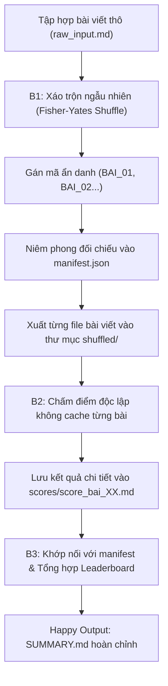

# 002-post-scorer (Kiểu Post Scorer không cache)

Hệ thống đánh giá và chấm điểm bài viết/tản văn/post/bài luận theo phương pháp **Post Scorer không cache (Uncached & Blind Evaluation)**, giúp loại bỏ hoàn toàn các thiên kiến tâm lý và thiên kiến ngữ cảnh của người chấm (hoặc mô hình ngôn ngữ), đảm bảo tính công tâm, khách quan và chuyên sâu tuyệt đối cho từng tác phẩm.

---

## 1. Triết lý "Không Cache" & Khắc phục Thiên kiến

Khi đọc và chấm một tập hợp gồm nhiều bài viết liên tục, người chấm (cả con người lẫn AI) luôn gặp phải 3 thiên kiến kinh điển:
1. **Thiên kiến neo điểm (Anchoring Bias):** Bài đầu tiên được đọc vô tình trở thành hệ quy chiếu "chuẩn". Nếu bài đầu quá hay, các bài sau bị chấm khắt khe hơn; nếu bài đầu yếu, các bài sau được nới tay quá mức.
2. **Thiên kiến vị trí (Positional / Sequence Bias):** Thứ tự xuất hiện làm lệch cảm nhận. Các bài ở giữa dễ bị lướt qua nhanh chóng, trong khi bài đầu và bài cuối thường nhận được sự chú ý không cân xứng.
3. **Suy giảm chất lượng do mang vác ngữ cảnh (Context Contamination & Attention Fatigue):** Việc chấm gộp 10–20 bài trong một lượt đọc duy nhất khiến bộ nhớ đệm (cache) bị trộn lẫn, các ý niệm từ bài trước tràn sang bài sau, dẫn tới việc đánh giá hời hợt hoặc so sánh thiên lệch thay vì nhìn nhận tác phẩm như một thực thể độc lập.

> [!IMPORTANT]
> **Nguyên tắc cốt lõi của Skill 002:**
> - **Bước 1 (Xáo bài - Blind Shuffle):** Toàn bộ bài viết đầu vào bắt buộc phải được xáo trộn ngẫu nhiên (Fisher-Yates) và gán mã ẩn danh (`BAI_01`, `BAI_02`,...). Thứ tự bài gốc được niêm phong vào `manifest.json`.
> - **Bước 2 (Chấm điểm độc lập không cache):** Từng bài được bóc tách thành file riêng biệt và tiến hành thẩm định trong một ngữ cảnh hoàn toàn cô lập (Stateless Evaluation), không tham chiếu hay so sánh với bất kỳ bài nào khác.
> - **Bước 3 (Tổng hợp Leaderboard):** Sau khi toàn bộ các bài đã có điểm số độc lập, hệ thống mới giải mã `manifest.json` để tổng hợp bảng xếp hạng và vẽ biểu đồ phổ điểm.

---

## 2. Quy trình thực hiện (Step-by-Step Workflow)



### Bước 1: Xáo bài và tạo Manifest (`shuffle_and_split.py`)
Tách văn bản nguồn theo ký hiệu phân tách (mặc định là `---`), xáo bài bằng random seed được ghi nhận, gán mã ẩn danh và xuất file bài viết lẻ:
```bash
python3 skills/002-post-scorer/scripts/shuffle_and_split.py \
  --input raw_input.md \
  --output-dir tmp/YYYYMMDD-[name] \
  --delimiter "---"
```

### Bước 2: Chấm điểm độc lập từng bài không cache
Người chấm (hoặc Agent) mở từng file `shuffled/bai_XX.md`, đánh giá chi tiết theo Rubric chuẩn hóa 100 điểm và xuất ra `scores/score_bai_XX.md`.
Tuyệt đối không so sánh "bài này hay hơn bài trước", mà chỉ đo lường bài viết dựa trên bộ tiêu chí khách quan.

### Bước 3: Tổng hợp báo cáo Leaderboard (`compile_summary.py`)
Sau khi chấm xong tất cả các bài, chạy script tổng hợp:
```bash
python3 skills/002-post-scorer/scripts/compile_summary.py \
  --dir tmp/YYYYMMDD-[name]
```

---

## 3. Ma trận Tiêu chí Chấm điểm Chuẩn mực (Thang điểm 100)

Bộ tiêu chí được thiết kế chuyên biệt cho thể loại tản văn, tùy bút, ghi chép phản tư hiện sinh:

| Tiêu chí | Trọng số | Nội dung đánh giá | Thang điểm |
| :--- | :---: | :--- | :---: |
| **1. Chiều sâu tư tưởng & Góc nhìn hiện sinh** | **25đ** | Khả năng vượt thoát góc nhìn thông thường; chạm đến căn tính con người, sự vô nghĩa tích cực, nghịch lý cuộc đời, ranh giới cái tôi. | Xuất sắc: 23–25<br>Tốt: 19–22<br>Khá: 15–18<br>Yếu: <15 |
| **2. Cảm xúc chân thực & Sức lay động** | **25đ** | Độ "thật" của cảm xúc; không sáo rỗng giáo điều, sức lay động lòng người từ những vụn vỡ, cô đơn hay lòng trắc ẩn vi tế. | Xuất sắc: 23–25<br>Tốt: 19–22<br>Khá: 15–18<br>Yếu: <15 |
| **3. Hình tượng nghệ thuật & Ngôn ngữ biểu đạt** | **20đ** | Tính biểu tượng của hình ảnh (người gác đền hơi thở, bầy mèo hải âu, bãi sh*t bên chí lớn...); từ ngữ sắc sảo, ẩn dụ giàu sức gợi. | Xuất sắc: 18–20<br>Tốt: 15–17<br>Khá: 12–14<br>Yếu: <12 |
| **4. Cấu trúc & Nhịp điệu văn bản** | **20đ** | Mạch dẫn dắt hữu cơ; sự tương phản câu dài - câu ngắn, khoảng lặng nhịp thở; cú hạ màn (punchline/câu chốt) để lại dư âm sâu. | Xuất sắc: 18–20<br>Tốt: 15–17<br>Khá: 12–14<br>Yếu: <12 |
| **5. Dấu ấn độc bản & Độ cô đọng** | **10đ** | Giọng điệu cá nhân độc nhất không thể trộn lẫn; tính cô đọng chắt lọc, không thừa thãi câu chữ. | Xuất sắc: 9–10<br>Tốt: 7–8<br>Khá: 5–6<br>Yếu: <5 |

---

## 4. Cấu trúc Thư mục Happy Output

Mọi dữ liệu của một phiên chấm điểm được lưu trọn vẹn trong `tmp/YYYYMMDD-[name]/`:

```
tmp/YYYYMMDD-[name]/
├── raw_input.md             # Văn bản gốc toàn bộ các bài viết
├── manifest.json            # Bản đồ giải mã (Seed, Shuffled ID <-> Original Index)
├── shuffled/                # Thư mục chứa từng bài viết đã xáo (ẩn danh)
│   ├── bai_01.md
│   ├── bai_02.md
│   └── ...
├── scores/                  # Thư mục kết quả chấm chi tiết từng bài
│   ├── score_bai_01.md
│   ├── score_bai_02.md
│   └── ...
└── SUMMARY.md               # Báo cáo tổng hợp: Leaderboard, Thống kê phổ điểm, Top 3 & Tra cứu
```

---

## 5. Mẫu File Đánh Giá Từng Bài (`scores/score_bai_XX.md`)

```markdown
# ĐÁNH GIÁ CHI TIẾT: BAI_XX

> **Mã ẩn danh:** `BAI_XX`
> **Trích dẫn nhận diện:** *"..."*

---

### Điểm số chi tiết theo Rubric

1. **Tư tưởng & Triết lý:** `23.0` / 25
   - *Nhận xét:* ...
2. **Cảm xúc & Chân thực:** `24.0` / 25
   - *Nhận xét:* ...
3. **Hình tượng & Ngôn ngữ:** `18.5` / 20
   - *Nhận xét:* ...
4. **Cấu trúc & Nhịp điệu:** `18.0` / 20
   - *Nhận xét:* ...
5. **Dấu ấn & Cô đọng:** `9.5` / 10
   - *Nhận xét:* ...

---

### **Tổng điểm:** `93.0` / 100  
**Xếp loại:** Xuất sắc (S)

### Câu văn đắt giá (Golden Quote)
> *"..."*

### Điểm sáng độc đáo (Core Strengths)
- ...

### Góp ý hoàn thiện (Constructive Critique)
- ...
```
